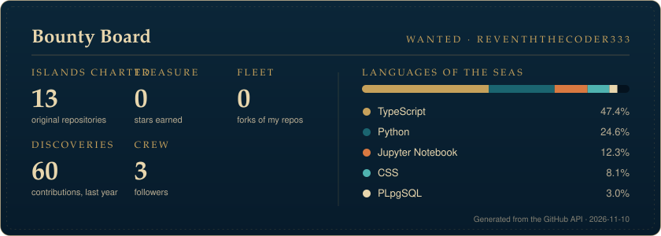

<div align="center">



<br/>

<a href="https://reventhsathishkumar.netlify.app"></a>
<a href="https://www.linkedin.com/in/reventh-sathishkumar"></a>
<a href="mailto:reventhsathishkumar@gmail.com"></a>

</div>

---

## 🧭 The Captain

> *"Every model starts as an uncharted island."*

Ahoy — I'm **Reventh**, a Computer Science student at **The University of Texas at Dallas** charting a course through **AI, machine learning, and software engineering**.

```yaml
captain:      Reventh Sathish Kumar
home_port:    The University of Texas at Dallas
voyage:       B.S. Computer Science — expected May 2028
log_pose:     GPA 3.875 / 4.00 · Dean's List (Fall 2025)
heading:      AI · Machine Learning · Computer Vision · NLP · Neural Interfaces
status:       Open to opportunities & collaborations
```

---

## 🏝️ Adventures — Islands I've Charted

<table>
<tr>
<td width="50%" valign="top">

### 🧠 Synapse Isle — [Neural Decoder](https://github.com/reventhTheCoder333/Neural-Decoder)
`In progress`<br/>
EEG-based decoder that predicts imagined **left vs. right hand movement** from brain activity.<br/>
<sub>Python · MNE-Python · PhysioNet EEGBCI · 8–30 Hz band-pass · CSP + LDA · Lab Streaming Layer</sub>

</td>
<td width="50%" valign="top">

### 🗼 Watchtower Key — [Sentry](https://github.com/reventhTheCoder333/Threat_Detection_Sentry)
`Completed`<br/>
Real-time AI safety system that detects **verbal threats and screams** in spoken audio and routes alerts to a phone.<br/>
<sub>Machine Learning · NLP · Real-time audio · Speech translation</sub>

</td>
</tr>
<tr>
<td width="50%" valign="top">

### 💊 Remedy Reef — [MedPred](https://github.com/reventhTheCoder333/Medication-Review-Condition-Predictor)
`Completed`<br/>
NLP classifier that reads medication reviews and predicts the condition — **91.6% accuracy** across 5 categories, with confidence scores.<br/>
<sub>Python · NLP · Machine Learning · Streamlit</sub>

</td>
<td width="50%" valign="top">

### 🧵 Loom Atoll — [Fold](https://github.com/reventhTheCoder333/CNNPracticeProject)
`Completed`<br/>
PyTorch CNN classifying **60,000 Fashion-MNIST images** across 10 clothing categories.<br/>
<sub>Python · PyTorch · torchvision · Google Colab (T4 GPU)</sub>

</td>
</tr>
<tr>
<td width="50%" valign="top">

### 📜 Scroll Harbor — [Resumix](https://github.com/reventhTheCoder333/Resumix)
AI-powered resume reviewer: overall rating, **ATS compatibility score**, and an interactive builder for an optimized resume.

</td>
<td width="50%" valign="top">

### 🛡️ Sieve Shoals — [SpamScope](https://github.com/reventhTheCoder333/SpamScope)
Spam classifier separating legitimate messages from junk — **98.5% accuracy**.<br/>
<sub>Python · Machine Learning</sub>

</td>
</tr>
<tr>
<td width="50%" valign="top">

### 🤝 Crew Cove — [Bondedd](https://github.com/reventhTheCoder333/Bondedd)
AI-powered campus networking platform for intent-based connections — teammates, study partners, and communities.<br/>
<sub>TypeScript</sub>

</td>
<td width="50%" valign="top">

### 🏛️ Vault Bay — [Data Warehouse](https://github.com/reventhTheCoder333/DataWarehouseProject)
T-SQL data warehouse covering end-to-end **ETL**, data modeling, and performance optimization.<br/>
<sub>T-SQL</sub>

</td>
</tr>
</table>

---

## 🍎 Devil Fruits — Powers Acquired

| Fruit | Type | Powers |
|:--|:--|:--|
| **Syntax-Syntax Fruit** <br/><sub>Programming Languages</sub> | Paramecia |       |
| **Neuro-Neuro Fruit** <br/><sub>AI / Machine Learning</sub> | Logia |         |
| **Forge-Forge Fruit** <br/><sub>Tools & Frameworks</sub> | Zoan |           |
| **Haki of Discipline** <br/><sub>Certifications</sub> | Trained, not eaten | NLP in Python · Python Data Science: Data Prep & EDA · Python ML & Data Science with Scikit-learn |

---

## 🗿 Poneglyph Discoveries — Research

> **Multimodal Argument Analysis** — *Data Annotator* · `Current`
>
> Annotating data for research into how arguments are expressed and understood when **visual and textual information** appear together — at the intersection of NLP, multimodal AI, and computational argumentation.

---

## 💰 Bounty Board — Live from GitHub

<div align="center">




<sub>Refreshed daily by a GitHub Action from the GitHub API — nothing on this board is hand-written.</sub>

</div>

---

## 📯 Hail the Ship

<div align="center">

| | |
|:--:|:--|
| 📧 | [reventhsathishkumar@gmail.com](mailto:reventhsathishkumar@gmail.com) |
| 💼 | [linkedin.com/in/reventh-sathishkumar](https://www.linkedin.com/in/reventh-sathishkumar) |
| 🗺️ | [reventhsathishkumar.netlify.app](https://reventhsathishkumar.netlify.app) |
| 📍 | Dallas, Texas |

<br/>

<sub><i>Repositories are islands · projects are adventures · commits are discoveries.</i></sub>

</div>
